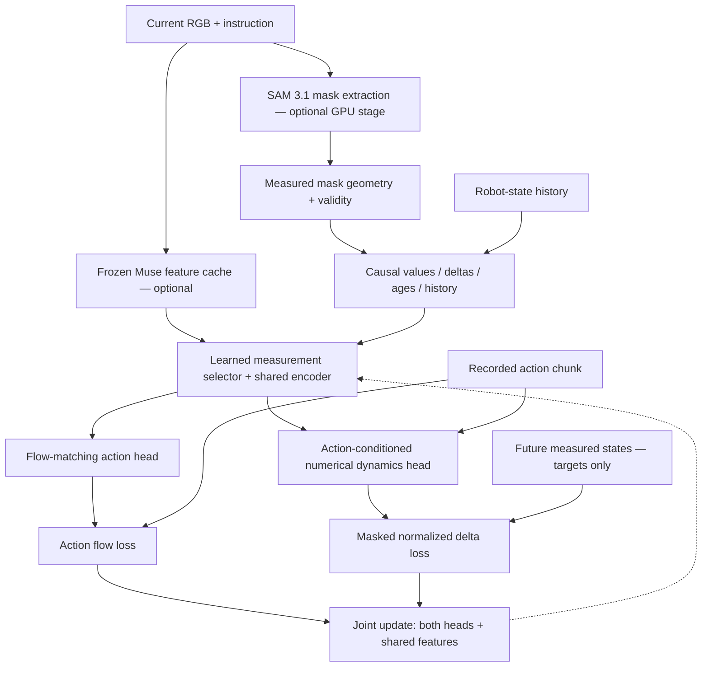
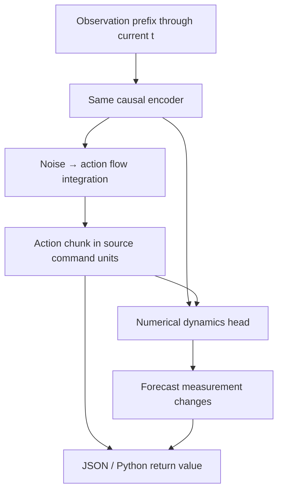

# Architecture: implemented experiment versus full research design

## Implemented v0.1 training graph

The action head is trained on interpolation between Gaussian noise and normalized
demonstration actions: `x_tau=(1-tau)*noise+tau*actions`. It predicts
`actions-noise`. At sampling, Euler integration runs from tau=0 to 1 using only
current shared context. Flow time tau is not the robot episode timestamp.

The dynamics head receives the same shared context plus **recorded** actions at
training/evaluation time. It predicts the future measured change from the current
anchor state. This forward model is a supervised numerical predictor; using
recorded actions is teacher forcing, not an autonomous rollout.

The shared encoder and selector receive gradients from both losses. A gradient
test checks that each objective reaches the shared encoder. Target measurements
are not gated by the learned selector, so it cannot reduce loss by suppressing
the target validity mask.

The original multi-step dynamics head consumes the **entire** action chunk;
its first output is therefore not guaranteed to be action-prefix-causal. For
passive monitoring there is now a separate `OneStepDynamicsHead`, trained from
a frozen policy encoder with only the current executed action and the next-state
delta. Existing multi-step checkpoints are unchanged. The one-step head is
validated offline; it is not yet a recovery controller. See
`docs/DIAGNOSTICS_REPORT.md`.

The prototype selector gates measurement types, shared across slots/history.
With Muse context it is scene/instruction conditioned; without it, state conditioned.
It does not yet learn local mask keypoints or a spatial attention map.

The temporal encoder is a compact MLP over explicit causal history, not a
Transformer, recurrent belief filter, or persistent learned contact model.

## Implemented inference

No controller is attached. The forecast is conditioned on the sampled chunk.
An eventual command validator may alter the chunk; then forecast again using
the accepted actions. The dynamics model must not silently predict effects for
one command while another is executed.

## Full design to investigate after the first experiment

1. **Measurement discovery:** task-conditioned regions/keypoints and relations.
2. **Desired effects:** instruction → desired relationship changes → motor policy.
3. **Controllability:** which objects respond to which robot actions.
4. **Interaction modes:** held/slipping/supported as uncertain predictive states.
5. **Belief under occlusion:** estimated state distributions and observation age.
6. **Prediction-error recovery:** compare expected effects with new measurements.
7. **Active sensing:** choose observations that resolve task-relevant uncertainty.
8. **Feasibility:** evaluate candidate effects against robot kinematics/geometry.

The current package implements the measurement/action learning core and the
offline comparison harness. The remaining modules are explicitly future work.
SAM segmentation does not directly provide metric object pose, physical volume,
mass, friction, graspability, or verified contact.

## Experimental claims and evidence

| Observation | Supported claim |
|---|---|
| Synthetic tests pass | Data/gradient/training plumbing works on the fixture |
| Dynamics beats persistence/velocity on held-out real demonstrations | Useful numerical prediction on that distribution |
| Removing actions worsens prediction | Actions add predictive information under that dataset |
| Auxiliary loss improves open-loop action error | Better offline imitation metric under the chosen comparison |
| Auxiliary loss improves simulator task success | Control benefit in the evaluated simulator distribution |
| Benefit repeats on the physical robot | Evidence for transfer under those tested conditions |

None of these alone proves a general physical world model, causal identification,
or novelty. We will report negative results and model/perception limitations.
